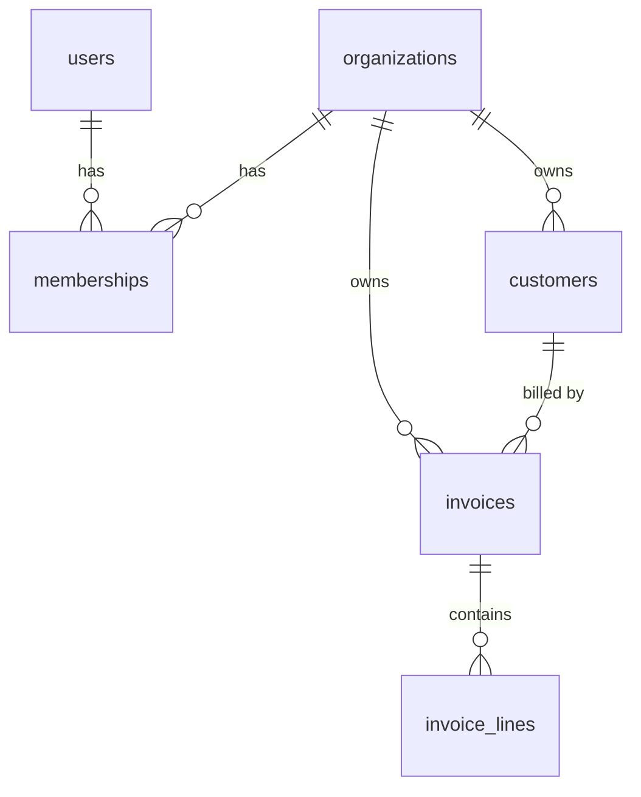
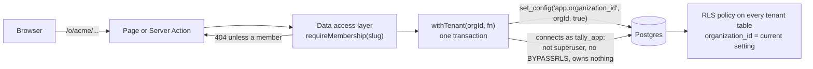
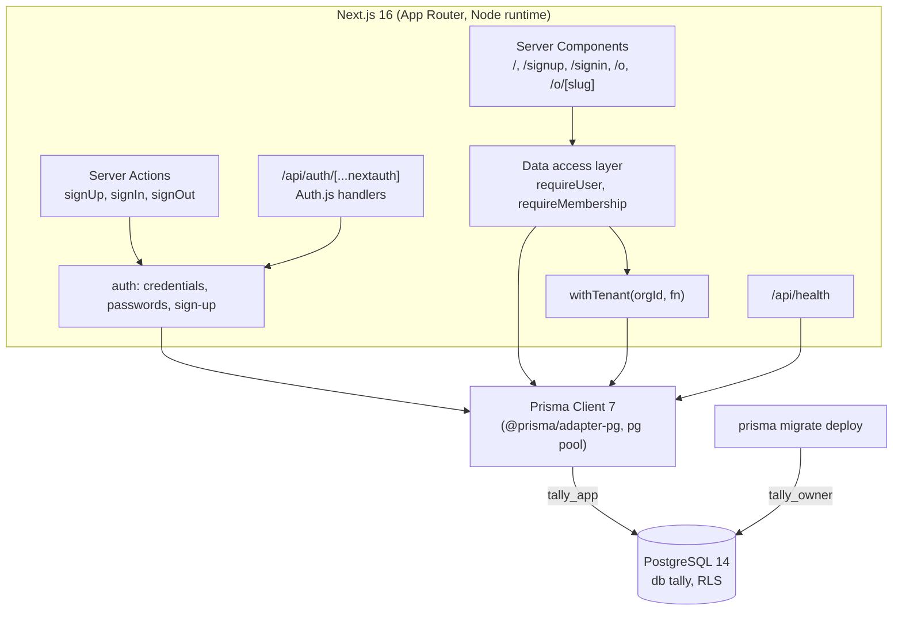

# Tally: design

Tally is a multi-tenant invoicing service: a business signs up, becomes an **organization**, invites its people,
keeps its **customers**, and sends them **invoices** with line items, taxes and payment through Stripe. Many
organizations share one database, so the property everything else rests on is **tenant isolation**: no request made
on behalf of one organization can read or change another organization's data, even when the application code has a
bug.

This file is the specification. When the code and this file disagree, one of them is wrong.

## Scope by day

| Day | Delivers |
|---|---|
| D1 | This design; the Next.js scaffold; the Prisma schema and migrations, including row-level security; database roles; sign-up and sign-in with Auth.js; CI. |
| D2 | Customers and invoices with line items; totals and taxes in exact decimal math; invoice numbering; invoice PDFs. |
| D3 | Billing: a Stripe client behind an interface (mocked in tests), webhooks with signature verification and idempotent processing. |
| D4 | Tenant-isolation test suite across every route, roles enforced, a background job for overdue reminders, Playwright e2e. |
| D5 | Deploy-ready configuration (no deploy), results, walkthrough, v1.0.0. |

## Domain model



| Table | Tenant-owned | Key columns |
|---|---|---|
| `users` | no | `id` uuid, `email` (unique, stored trimmed and lower-cased), `name`, `password_hash` |
| `organizations` | no (it *is* the tenant) | `id` uuid, `name`, `slug` (unique, used in URLs) |
| `memberships` | no | (`organization_id`, `user_id`) primary key, `role` (`OWNER`, `ADMIN`, `MEMBER`) |
| `customers` | yes | `id`, `organization_id`, `name`, `email`; unique (`organization_id`, `email`) |
| `invoices` | yes | `id`, `organization_id`, `customer_id`, `status` (`DRAFT`, `OPEN`, `PAID`, `VOID`), `currency`, `number` (null while a draft) |
| `invoice_lines` | yes | `id`, `organization_id`, `invoice_id`, `position`, `description`, `quantity`, `unit_price_minor` |

Ids are UUIDs generated by Postgres (`gen_random_uuid()`), so raw SQL, tests and the application agree on them, and an
id reveals nothing about how many rows exist. Every tenant-owned table carries `organization_id` itself, even
`invoice_lines`, whose organization is implied by its invoice: the column is what the row-level security policy and
the composite foreign keys below use, and it keeps every tenant query a single-table filter.

Money columns (D2 finishes them): amounts are integers in the currency's minor unit (`bigint` cents for USD), never
floating point; quantities are `numeric`; invoice numbers are per organization and assigned when a draft is
finalized, so the numbers that customers see have no gaps.

## Tenant isolation

Three independent layers. Each is enough to stop the common bugs on its own; together they mean a single mistake
(a forgotten `where`, a wrong id from the URL, a raw query) doesn't become a cross-tenant leak.



### Layer 1: every tenant route resolves a membership first

Tenant pages live under `/o/[slug]/...`. The page (or Server Action) calls `requireMembership(slug)` from the data
access layer (`src/server/dal.ts`), which reads the session's user id, loads the membership of that user in the
organization with that slug, and returns `{ user, organization, role }` (`requireTenant` adds `run`, below). A user who isn't a member gets the same
404 as a slug that doesn't exist, so the response doesn't reveal which organizations exist. The check runs in each
page and action, not only in a layout or the proxy: layouts don't re-run on client navigation, and a proxy-only check
is one bypass away from no check at all.

The session holds only the user id. Membership and role are read from the database on every request, so removing
someone from an organization takes effect on their next request even though a JWT can't be revoked.

### Layer 2: tenant data is only reachable through `withTenant`

`withTenant(organizationId, fn)` (`src/server/db/tenant.ts`) opens one interactive transaction, runs
`SELECT set_config('app.organization_id', $1, true)` in it, and passes the transaction's client to `fn`. The third
argument, `true`, makes the setting **local to the transaction**: when it commits or rolls back, the setting is gone,
so a pooled connection handed to the next request carries no tenant. A session-level `SET` would leak the previous
request's tenant to whichever request gets that connection next; a test pins this.

The organization id passed in comes from `requireMembership`, never from the request body or the URL directly. To
make that structural rather than a convention, pages and Server Actions call `requireTenant(slug)`
(`src/server/dal.ts`), which is `requireMembership` plus a `run(fn)` already bound to the membership's organization:
they never hold an organization id to pass. Two architecture tests over the source (`tests/unit/architecture.test.ts`)
check that `withTenant` is called only from the data access layer, and that every query on a tenant table runs on a
transaction client (`tx`), not on a plain client, where row-level security would silently return nothing.

### Layer 3: Postgres row-level security

Every tenant-owned table has RLS **enabled and forced**, and one policy:

```sql
CREATE POLICY tenant_isolation ON customers
  USING      (organization_id = NULLIF(current_setting('app.organization_id', true), '')::uuid)
  WITH CHECK (organization_id = NULLIF(current_setting('app.organization_id', true), '')::uuid);
```

- `USING` filters what `SELECT`, `UPDATE` and `DELETE` can see; `WITH CHECK` refuses an `INSERT` or `UPDATE` that
  would produce a row of another organization. Moving a row to another tenant is refused, not silently hidden.
- With no setting, `current_setting(..., true)` returns `NULL` (never set in this session) or `''` (set earlier in
  the session by a transaction that has since ended: Postgres keeps the placeholder with an empty value). `NULLIF`
  turns both into `NULL`, `organization_id = NULL` is never true, and **a query without a tenant sees no rows and can
  insert none**. Without the `NULLIF`, the `''` case would be a cast error instead; either is safe, but an empty
  result is the documented behaviour and tests cover both cases.
- A malformed setting is a cast error, which fails the transaction loudly.
- The expression is written inline, not as a function, so the planner can treat it as a constant and use the
  `(organization_id, ...)` indexes.

RLS only binds roles that are subject to it. **Superusers and roles with `BYPASSRLS` skip every policy, and a table's
owner skips them unless the table is `FORCE`d.** So there are two roles:

| Role | Used by | Can |
|---|---|---|
| `tally_owner` | migrations (`prisma migrate deploy`) | owns the schema's tables; DDL |
| `tally_app` | the running application, tests of isolation | `SELECT`, `INSERT`, `UPDATE`, `DELETE` on the application's tables, granted table by table in the migrations; `USAGE` on sequences it needs; nothing else. `NOSUPERUSER NOBYPASSRLS`, owns nothing |

At startup (`instrumentation.ts`) and in the health check, `assertSafeAppRole()` asks Postgres who it is connected as
and refuses to serve if that role is a superuser, has `BYPASSRLS`, or owns a tenant table, because any of those would
silently switch layer 3 off. `scripts/db-setup.sh` creates the roles and databases; it is idempotent.

### Composite foreign keys: a cross-tenant reference can't be stored

`customers` has a unique key on (`organization_id`, `id`), and `invoices` references a customer by
(`organization_id`, `customer_id`), not by `customer_id` alone; `invoice_lines` references its invoice the same way.
An invoice of organization A pointing at a customer of organization B is therefore not a row the schema can hold,
whoever writes it, including a migration or a superuser.

This also closes the one channel RLS leaves open: Postgres checks foreign keys without applying row security, so with
a plain `customer_id` foreign key, an insert's success or failure would tell a tenant whether *another* tenant's
customer id exists. With the composite key, another tenant's customer id fails exactly like a random one.

### What RLS doesn't cover, and why

`users`, `organizations` and `memberships` have no policies: they are read before a tenant is known (signing in,
resolving a slug). They are reached only through `src/server/auth/` and `src/server/dal.ts`, which always filter by
the session's user id. D4's isolation suite checks every route against a second organization's ids.

## Authentication

Auth.js v5 (`next-auth@5.0.0-beta.32`; v5 has been in beta for a long time, but it is the version written for the App
Router and the one Auth.js documents) with the **Credentials** provider and **JWT sessions** (Auth.js requires JWT
sessions with Credentials). The JWT is an encrypted, HTTP-only cookie signed with `AUTH_SECRET`; it carries only the
user's id (`sub`).

- **Passwords** are hashed with scrypt from Node's `crypto` (N = 2^15, r = 8, p = 1, a 16-byte random salt, a 32-byte
  key), stored as `scrypt$<N>$<r>$<p>$<salt>$<key>` (base64url), so parameters can be raised later and old hashes
  still verify. Comparison is constant-time (`timingSafeEqual`). No native dependency (bcrypt, argon2) to build in
  CI. Passwords are 10 to 128 characters; the upper bound caps the hashing work an anonymous request can cause.
- **Unknown email:** sign-in still runs one scrypt against a fixed dummy hash, so the response time doesn't tell an
  attacker which emails have accounts. The error message is the same in both cases.
- **Emails** are trimmed and lower-cased before they're stored or looked up; the unique index is on that form.
- **Sign-up** creates the user, the organization and an `OWNER` membership in one transaction. If the email is taken,
  nothing is created. The organization's slug comes from its name (`Acme, Inc.` → `acme-inc`); if that slug is taken,
  a short random suffix is added and the insert retried, so two concurrent sign-ups with the same name both succeed.
- **Sessions are not authority.** The session says who you are; what you may do is read from `memberships` on each
  request (layer 1). A deleted user's session stops working on the next request because the user lookup fails.
- Next.js Server Actions check the request's `Origin` against the host, and Auth.js protects its own endpoints with a
  CSRF token. Rate limiting sign-in is a D4 item.
- Every response carries security headers (`next.config.ts`): `frame-ancestors 'none'` and `X-Frame-Options: DENY`
  against clickjacking, `nosniff`, a referrer policy that keeps invoice URLs on the site, a Permissions-Policy, and
  HSTS for HTTPS deployments. There is no `script-src` yet: Next.js's inline scripts would need a per-request nonce,
  which makes every page dynamic.

### Roles

| Permission | OWNER | ADMIN | MEMBER |
|---|---|---|---|
| View customers and invoices | yes | yes | yes |
| Create and edit customers, draft invoices | yes | yes | yes |
| Finalize, void, mark paid | yes | yes | no |
| Invite and remove members, change roles | yes | yes (not owners) | no |
| Billing settings, delete organization | yes | no | no |

D1 stores the role; D4 enforces this table in the data access layer and tests every cell of it.

## Architecture



- **Next.js 16, App Router, Server Components and Server Actions.** Pages render on the server and read the database
  through the data access layer; forms post to Server Actions, so there is no separate API for the UI to keep in sync
  with. Route Handlers exist only for Auth.js, the health check and (D3) Stripe webhooks.
- **Prisma 7** with the `prisma-client` generator (TypeScript output in `src/generated/prisma`, gitignored, produced
  by `npm install`'s `postinstall`) and the `pg` driver adapter. The schema is `prisma/schema.prisma`; migrations are
  SQL files in `prisma/migrations/`, and the RLS policies, grants and checks that Prisma's schema language can't
  express are written into those SQL files by hand.
- **Zod** validates every form and action input at the boundary.

## Repository layout

```
prisma/schema.prisma            the data model
prisma/migrations/              SQL migrations, including RLS and grants
prisma.config.ts                Prisma CLI configuration (migration URL)
scripts/db-setup.sh             roles and databases, idempotent
src/app/                        routes (App Router)
src/server/db/                  Prisma clients (app and owner), withTenant, the role check
src/server/auth/                passwords, credential verification, sign-up
src/server/dal.ts               requireUser, requireMembership, requireTenant
src/auth.ts                     the Auth.js configuration
tests/                          Vitest: unit tests and integration tests against Postgres
```

## Environments and configuration

| Variable | Meaning | Local default (`.env.example`) |
|---|---|---|
| `DATABASE_URL` | the application's connection, as `tally_app` | `postgresql://tally_app@localhost:5432/tally` |
| `MIGRATE_DATABASE_URL` | migrations, as `tally_owner` | `postgresql://tally_owner@localhost:5432/tally` |
| `AUTH_SECRET` | Auth.js cookie encryption key | none: generate with `openssl rand -base64 32` into `.env` |

Local Postgres 14 runs on the default port 5432 with trust authentication for local connections, so no database
password exists anywhere in the repository; CI's service container runs with `POSTGRES_HOST_AUTH_METHOD=trust` for
the same reason. The app listens on port 8117. Tests use a separate database, `tally_test`.

## Testing

- **Unit (Vitest):** password hashing and verification, slugs, input schemas.
- **Integration (Vitest against a real Postgres, `tally_test`):** migrations applied by `prisma migrate deploy`; then
  isolation proofs run as `tally_app`: no tenant set means no rows and no inserts (both the never-set and the
  set-then-ended cases); a tenant sees only its rows; an insert or update into another tenant is refused; a
  cross-tenant foreign key is refused; the tenant setting doesn't survive its transaction on a pooled connection;
  the role check refuses the owner role (and, in unit tests, a superuser or a BYPASSRLS role). And the auth flows: sign-up is atomic, duplicate emails are refused, concurrent
  sign-ups with the same organization name both get a slug, credentials verify only with the right password.
- **Architecture (Vitest over the source):** tenant tables are only queried on a `withTenant` transaction, and
  `withTenant` is only called from the data access layer.
- **e2e (Playwright):** a browser signs up, signs out and signs in; failed sign-ins look the same either way; another
  organization's page is a 404 like a missing one; the security headers are on every kind of response. D4 extends
  this to every route.
- **CI (GitHub Actions):** a Postgres 14 service container; `npm ci`, the setup script, migrations, typecheck, lint,
  tests and `next build` on Node 22 and 24.

## Versions

Node 22.12+ or 24 (Prisma 7 and Vitest 5 require one of those; CI tests both). Next.js 16.4.5, React 19.3.1,
Prisma 7.10.1, Auth.js 5.0.0-beta.32, Zod 4.6.7, TypeScript 5.9.3, Vitest 5.1.0, ESLint 9.39.5. Every version is
pinned exactly and was at least a week old when chosen. TypeScript stays on 5.9 because typescript-eslint supports
TypeScript below 6.1 and TypeScript 7 (the native compiler) doesn't yet have the compiler API that Next.js's type
check uses.
