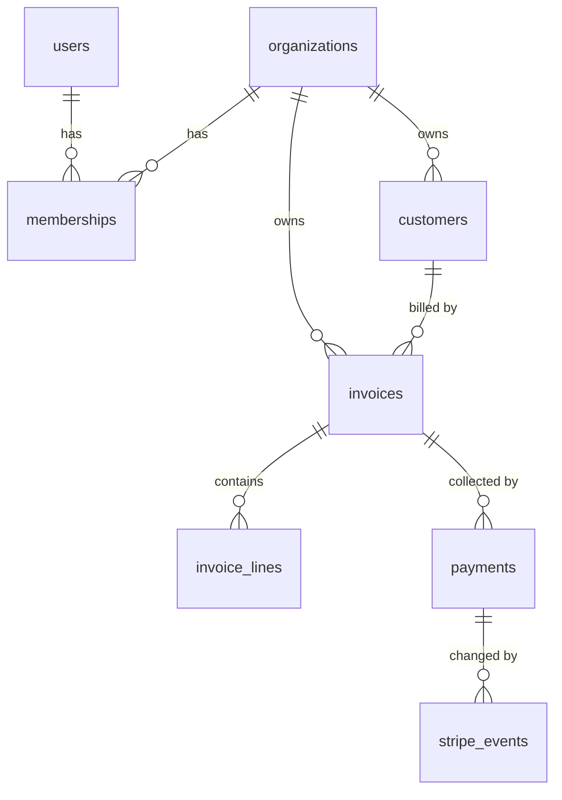
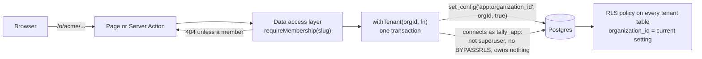
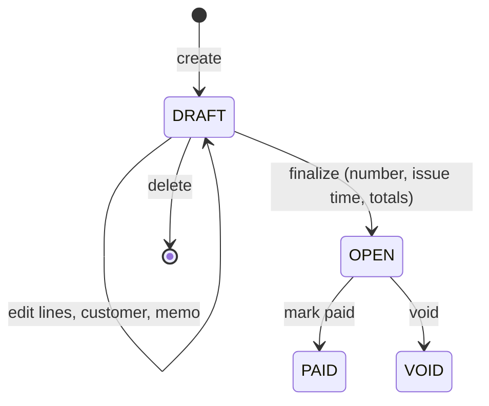
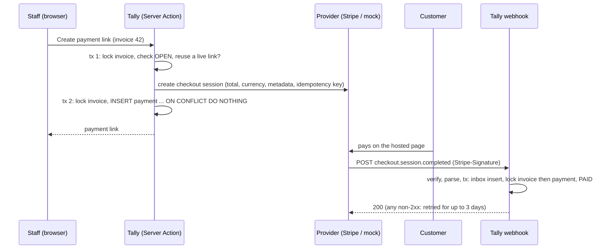
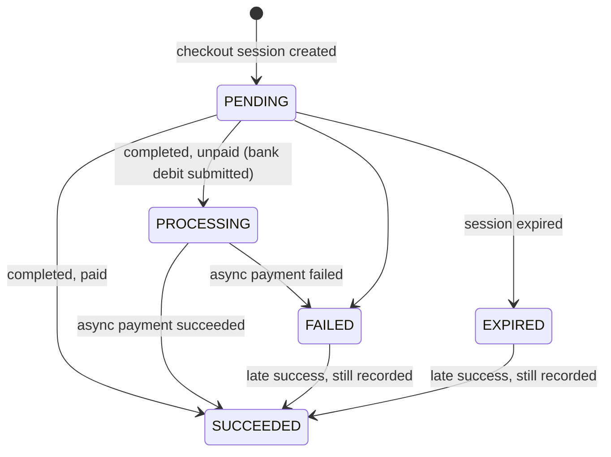
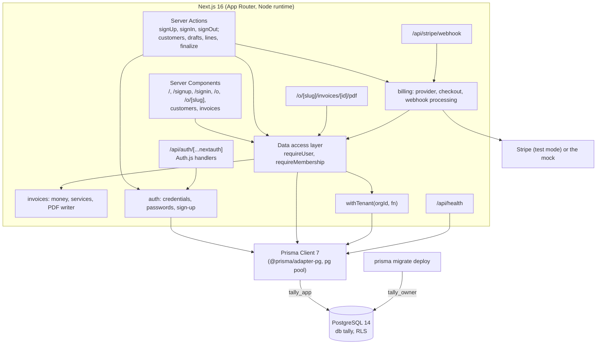

# Tally: design

Tally is a multi-tenant invoicing service: a business signs up, becomes an **organization**, invites its people,
keeps its **customers**, and sends them **invoices** with line items, taxes and payment through Stripe. Many
organizations share one database, so the property everything else rests on is **tenant isolation**: no request made
on behalf of one organization can read or change another organization's data, even when the application code has a
bug.

This file is the specification. When the code and this file disagree, one of them is wrong.

## Scope by day

| Day | Delivers |
|---|---|
| D1 | This design; the Next.js scaffold; the Prisma schema and migrations, including row-level security; database roles; sign-up and sign-in with Auth.js; CI. |
| D2 | Customers and invoices with line items; totals and taxes in exact decimal math; gapless invoice numbering; the invoice life cycle enforced in the database; invoice PDFs. |
| D3 | Billing: a Stripe client behind an interface (mocked in tests), webhooks with signature verification and idempotent processing. |
| D4 | Tenant-isolation test suite across every route, roles enforced, a background job for overdue reminders, Playwright e2e. |
| D5 | Deploy-ready configuration (no deploy), results, walkthrough, v1.0.0. |

## Domain model



| Table | Tenant-owned | Key columns |
|---|---|---|
| `users` | no | `id` uuid, `email` (unique, stored trimmed and lower-cased), `name`, `password_hash` |
| `organizations` | no (it *is* the tenant) | `id` uuid, `name`, `slug` (unique, used in URLs) |
| `memberships` | no | (`organization_id`, `user_id`) primary key, `role` (`OWNER`, `ADMIN`, `MEMBER`) |
| `customers` | yes | `id`, `organization_id`, `name`, `email`, `address`; unique (`organization_id`, `email`) |
| `invoices` | yes | `id`, `organization_id`, `customer_id`, `status` (`DRAFT`, `OPEN`, `PAID`, `VOID`), `currency`, `memo`; set at finalization: `number`, `issued_at`, `due_on`, `subtotal_minor`, `tax_minor`, `total_minor` |
| `invoice_lines` | yes | `id`, `organization_id`, `invoice_id`, `position`, `description`, `quantity`, `unit_price_minor`, `tax_rate` |
| `invoice_counters` | yes | `organization_id` (primary key), `last_number` |
| `payments` | yes | `id`, `organization_id`, `invoice_id`, `provider`, `checkout_session_id`, `checkout_url`, `amount_minor`, `currency`, `status`, `expires_at`, `payment_intent_id`, `paid_at`, `refund_due` |
| `stripe_events` | yes | `id` (Stripe's event id), `organization_id`, `type`, `payment_id`, `outcome`, `stripe_created_at` |

Ids are UUIDs generated by Postgres (`gen_random_uuid()`), so raw SQL, tests and the application agree on them, and an
id reveals nothing about how many rows exist. Every tenant-owned table carries `organization_id` itself, even
`invoice_lines`, whose organization is implied by its invoice: the column is what the row-level security policy and
the composite foreign keys below use, and it keeps every tenant query a single-table filter.

Money: amounts are integers in the currency's minor unit (`bigint` cents for USD), never floating point; quantities
and tax rates are `numeric` with three decimals; invoice numbers are per organization and assigned when a draft is
finalized, so the numbers that customers see have no gaps. "Invoices" below has the rules.

## Tenant isolation

Three independent layers. Each is enough to stop the common bugs on its own; together they mean a single mistake
(a forgotten `where`, a wrong id from the URL, a raw query) doesn't become a cross-tenant leak.



### Layer 1: every tenant route resolves a membership first

Tenant pages live under `/o/[slug]/...`. The page (or Server Action) calls `requireMembership(slug)` from the data
access layer (`src/server/dal.ts`), which reads the session's user id, loads the membership of that user in the
organization with that slug, and returns `{ user, organization, role }` (`requireTenant` adds `run`, below). A user who isn't a member gets the same
404 as a slug that doesn't exist, so the response doesn't reveal which organizations exist. The check runs in each
page and action, not only in a layout or the proxy: layouts don't re-run on client navigation, and a proxy-only check
is one bypass away from no check at all.

The session holds only the user id. Membership and role are read from the database on every request, so removing
someone from an organization takes effect on their next request even though a JWT can't be revoked.

### Layer 2: tenant data is only reachable through `withTenant`

`withTenant(organizationId, fn)` (`src/server/db/tenant.ts`) opens one interactive transaction, runs
`SELECT set_config('app.organization_id', $1, true)` in it, and passes the transaction's client to `fn`. The third
argument, `true`, makes the setting **local to the transaction**: when it commits or rolls back, the setting is gone,
so a pooled connection handed to the next request carries no tenant. A session-level `SET` would leak the previous
request's tenant to whichever request gets that connection next; a test pins this.

Two guards around `fn` keep the transaction's outcome and its writes in agreement (both found by review round 1):

- **No writes after the rollback.** If `fn` rejects while one of its queries is still running (a `Promise.all`
  sibling threw), Prisma 7.10 sends `ROLLBACK` and releases the connection, and the rest of a multi-query operation
  (a nested write) then runs outside any transaction and commits. `fn` therefore gets a view of the transaction
  that records each Prisma promise once it starts, and `withTenant` waits for all of them before rolling back or
  committing.
- **No statement outlives the transaction.** Prisma's own transaction timeout does the same release mid-plan
  (review round 2), so `withTenant` sets `lock_timeout` (2 s) and `statement_timeout` (5 s) locally, in the same
  statement as the tenant, and gives Prisma a 30 s timeout: a stuck statement fails inside the transaction first.
- **No success for an aborted transaction.** If `fn` catches a database error and returns, Postgres has already
  aborted the transaction and answers `COMMIT` with a silent `ROLLBACK`. One `SELECT 1` after `fn` turns that into
  an error instead of a success for writes that were never stored.

The organization id passed in comes from `requireMembership`, never from the request body or the URL directly. To
make that structural rather than a convention, pages and Server Actions call `requireTenant(slug)`
(`src/server/dal.ts`), which is `requireMembership` plus a `run(fn)` already bound to the membership's organization:
they never hold an organization id to pass. Two architecture tests over the source (`tests/unit/architecture.test.ts`)
check that `withTenant` is called only from the data access layer, and that every query on a tenant table runs on a
transaction client (`tx`), not on a plain client, where row-level security would silently return nothing.

### Layer 3: Postgres row-level security

Every tenant-owned table has RLS **enabled and forced**, and one policy:

```sql
CREATE POLICY tenant_isolation ON customers
  USING      (organization_id = NULLIF(current_setting('app.organization_id', true), '')::uuid)
  WITH CHECK (organization_id = NULLIF(current_setting('app.organization_id', true), '')::uuid);
```

- `USING` filters what `SELECT`, `UPDATE` and `DELETE` can see; `WITH CHECK` refuses an `INSERT` or `UPDATE` that
  would produce a row of another organization. Moving a row to another tenant is refused, not silently hidden.
- With no setting, `current_setting(..., true)` returns `NULL` (never set in this session) or `''` (set earlier in
  the session by a transaction that has since ended: Postgres keeps the placeholder with an empty value). `NULLIF`
  turns both into `NULL`, `organization_id = NULL` is never true, and **a query without a tenant sees no rows and can
  insert none**. Without the `NULLIF`, the `''` case would be a cast error instead; either is safe, but an empty
  result is the documented behaviour and tests cover both cases.
- A malformed setting is a cast error, which fails the transaction loudly.
- The expression is written inline, not as a function, so the planner can treat it as a constant and use the
  `(organization_id, ...)` indexes.

RLS only binds roles that are subject to it. **Superusers and roles with `BYPASSRLS` skip every policy, and a table's
owner skips them unless the table is `FORCE`d.** So there are two roles:

| Role | Used by | Can |
|---|---|---|
| `tally_owner` | migrations (`prisma migrate deploy`) | owns the schema's tables; DDL |
| `tally_app` | the running application, tests of isolation | `SELECT` on the application's tables, and `INSERT`/`UPDATE`/`DELETE` granted **column by column** (`*_least_privilege`): never on `id` or `organization_id`, no `DELETE` on `users` or `organizations`, no `TRUNCATE`, `REFERENCES` or `TRIGGER`. `NOSUPERUSER NOBYPASSRLS`, owns nothing |

Organizations can't be updated by the app at all (review round 2: with no RLS on organizations, `UPDATE (name, slug)`
let one tenant rename another or take its slug); day 4's settings page will add a policy-guarded path.

The narrow grants matter because some writes run without row security even for `tally_app`: foreign-key actions
(`ON DELETE CASCADE` from an organization through its customers and invoices) and unique-key checks. So the app may
not delete organizations or users (an administrator does, as the owner), may not change any id (every key is
`ON UPDATE NO ACTION`, so an id change can't cascade either), and may not choose ids (Postgres generates them;
`created_at` comes from the database's clock too). An administrator deletes users and organizations as the owner role
(the roles table's "delete organization" for OWNER needs that path on day 4).

At startup (`instrumentation.ts`) and in the health check, `assertSafeAppRole()` (`src/server/db/role-check.ts`) asks
Postgres who the connection is and refuses to serve if any of these would switch layer 3 off or around: the role is a
superuser, has `BYPASSRLS`, or is a member of any other role (it is `NOINHERIT`, so a membership's privileges only
show after `SET ROLE`); the session logged in as a different role (a superuser can `RESET ROLE`); it may execute a
`SECURITY DEFINER` function; it owns (or can become the owner of) an
application table; RLS isn't enabled and forced on a protected table; the policies differ in any way from the
migrations' (name, command, both expressions as Postgres deparses them, permissive, for everyone), so an added
`USING (true)` policy is caught; the role holds any privilege the least-privilege migration took away; or the
connection starts with `app.organization_id` already set (a URL `options=-c ...` or a role default). The startup
check gives up and exits after 15 s, and connections give up after 5 s, so a database that never answers can't leave a
server that neither serves nor exits. `scripts/db-setup.sh` creates the roles and databases; it is idempotent.

### Composite foreign keys: a cross-tenant reference can't be stored

`customers` has a unique key on (`organization_id`, `id`), and `invoices` references a customer by
(`organization_id`, `customer_id`), not by `customer_id` alone; `invoice_lines` references its invoice the same way.
An invoice of organization A pointing at a customer of organization B is therefore not a row the schema can hold,
whoever writes it, including a migration or a superuser.

This also closes a channel RLS leaves open: Postgres checks foreign keys **and unique keys** without applying row
security, so a key that spans tenants answers "does this exist in another tenant?". With a plain `customer_id`
foreign key, another tenant's customer id would fail differently from a random one; with the composite key it fails
the same way. Review round 1 found the unique-key version: a line at a position another tenant's invoice used failed
on `(invoice_id, position)` where a random invoice id failed the foreign key, and an insert with another tenant's
customer id failed on the primary key where a random id succeeded. So unique keys on tenant tables start with
`organization_id`, and the app can't supply ids at all.

### Memberships

Memberships decide who may act for an organization, so every layer trusts them. They are under forced RLS too, with
four policies: readable without a tenant (signing in and resolving a slug happen before one is known), but inserted,
updated and deleted only for the transaction's tenant. Sign-up sets its new organization as the tenant before adding
the first member; invitations (day 4) run inside `requireTenant`. Before this (review round 1), one call inside
tenant A's `withTenant` could make a user an OWNER of tenant B.

### What RLS doesn't cover, and why

`users` and `organizations` have no policies, and memberships have none for reading: they are read before a tenant is
known (signing in, resolving a slug). What limits writes to them is the grants: the app can create users and
organizations and rename organizations, but can't delete either or change an id. They are reached only through
`src/server/auth/` and `src/server/dal.ts`, which always filter by the session's user id. D4's isolation suite checks
every route against a second organization's ids.

## Authentication

Auth.js v5 (`next-auth@5.0.0-beta.32`; v5 has been in beta for a long time, but it is the version written for the App
Router and the one Auth.js documents) with the **Credentials** provider and **JWT sessions** (Auth.js requires JWT
sessions with Credentials). The JWT is an encrypted, HTTP-only cookie signed with `AUTH_SECRET`; it carries only the
user's id (`sub`).

- **Passwords** are hashed with scrypt from Node's `crypto` (N = 2^15, r = 8, p = 1, a 16-byte random salt, a 32-byte
  key), stored as `scrypt$<N>$<r>$<p>$<salt>$<key>` (base64url), so parameters can be raised later and old hashes
  still verify. Comparison is constant-time (`timingSafeEqual`). No native dependency (bcrypt, argon2) to build in
  CI. Passwords are 10 to 128 characters; the upper bound caps the hashing work an anonymous request can cause.
  Parameters read back from a stored hash are bounded (N 2^14 to 2^20, r up to 32, p up to 16, and 128 * N * r at
  most 128 MiB), so every hash that parses can be verified and none can make one sign-in take gigabytes.
- **Unknown email:** sign-in still runs one scrypt against a fixed dummy hash, so the response time doesn't tell an
  attacker which emails have accounts. The error message is the same in both cases.
- **Emails** are trimmed and lower-cased before they're stored or looked up; the unique index is on that form.
  **Names** may not contain control characters (Postgres text can't hold NUL, which made sign-up a 500).
- **Sign-up** creates the user, the organization and an `OWNER` membership in one transaction. If the email is taken,
  nothing is created. The organization's slug comes from its name (`Acme, Inc.` → `acme-inc`); if that slug is taken,
  a short random suffix is added and the insert retried, so two concurrent sign-ups with the same name both succeed.
- **Sessions are not authority.** The session says who you are; what you may do is read from `memberships` on each
  request (layer 1). A deleted user's session stops working on the next request because the user lookup fails.
- Next.js Server Actions check the request's `Origin` against the host, and Auth.js protects its own endpoints with a
  CSRF token. Rate limiting sign-in is a D4 item.
- Every response carries security headers (`next.config.ts`): `frame-ancestors 'none'` and `X-Frame-Options: DENY`
  against clickjacking, `nosniff`, a referrer policy that keeps invoice URLs on the site, a Permissions-Policy, and
  HSTS for HTTPS deployments. There is no `script-src` yet: Next.js's inline scripts would need a per-request nonce,
  which makes every page dynamic.

### Roles

| Permission | OWNER | ADMIN | MEMBER |
|---|---|---|---|
| View customers and invoices | yes | yes | yes |
| Create and edit customers, draft invoices | yes | yes | yes |
| Finalize, void, mark paid | yes | yes | no |
| Invite and remove members, change roles | yes | yes (not owners) | no |
| Billing settings, delete organization | yes | no | no |

D1 stores the role; D4 enforces this table in the data access layer and tests every cell of it.

## Invoices

### Money

`src/server/invoices/money.ts` is the arithmetic, and nothing in it is a JavaScript `number`:

| Quantity | Representation | Example |
|---|---|---|
| amount | `bigint` count of the currency's minor unit (ISO 4217 digits: USD 2, JPY 0, KWD 3) | $12.34 = `1234n` |
| quantity | `bigint` thousandths (`numeric(12,3)` in the database) | 1.5 = `1500n` |
| tax rate | `bigint` thousandths of a percent (`numeric(6,3)`) | 8.875% = `8875n` |

- **Parsing never rounds.** "12.345" USD is refused ("at most 2 decimals"), not rounded; so are signs, exponents,
  thousands separators and anything that isn't plain digits with one optional point. What a user typed is what's
  stored.
- **The rounding rule, stated once:** each line's amount is quantity x unit price rounded half up to the minor unit;
  tax is computed **once per rate**, on the sum of that rate's line amounts, rounded half up; the total is subtotal
  plus taxes with no further rounding. Per rate rather than per line keeps each rate's tax within half a minor unit of
  the exact tax however many lines share it (three $0.10 lines at 5% owe 1.5 cents: per line that's 3 cents, per
  rate 2), and it's how VAT invoices are usually totalled. All amounts are non-negative (no discounts or credit
  notes yet), so half up and half away from zero are the same rule.
- **Limits that keep every invoice inside `bigint`:** at most 100 lines, quantity 1,000,000, unit price 10^10 minor
  units, rate 100%: the largest possible total is 2 x 10^18 < 9.22 x 10^18. The database has the same limits as CHECK
  constraints (and the line cap in a trigger).
- **Display:** `Intl.NumberFormat` formats the decimal *string* ("1234.56"), which ECMA-402 treats exactly, so no
  amount passes through a double on the way to the screen.

### Life cycle



The database enforces it for every writer, not just the services (`invoices_guard`, a `BEFORE INSERT OR UPDATE OR
DELETE` trigger): a new invoice is a draft; a draft can only be edited, finalized or deleted; once out of draft
nothing but the status changes, and only OPEN → PAID or OPEN → VOID; only drafts can be deleted (a deleted numbered
invoice would be a gap), except inside the organization's own deletion cascade. `invoice_lines_guard` lets lines change
only while their invoice is a draft, never moves a line to another invoice, and caps lines at 100. The currency is fixed at creation, because prices are stored
in its minor unit. The triggers raise their own SQLSTATEs (`TL001`-`TL010`), which `refusals()` in the services maps
to the same results the services' own checks return.

`refusals()` wraps a whole `run(...)`, never a call inside it: a refused statement has aborted the transaction, so
the error has to reach `withTenant` (which rolls back) before it becomes a result. It also maps the unique key
`(organization_id, email)` on customers to "email-taken" (the first version caught that inside the transaction and
was a 500), and, per call, the foreign key from invoices to customers: "has-invoices" for a delete, "no-customer" for
a draft whose customer was deleted between the service's check and its write.

### Bill-to details

A finalized invoice keeps who it was issued to: the trigger copies the customer's name, email and address into
`bill_to_name`, `bill_to_email`, `bill_to_address` at finalization, and they are frozen with everything else.
Before, an issued invoice's page and PDF followed later edits to the customer (review round 1's suspicion, confirmed
by a test). A draft still shows the customer as it is. The organization's own name isn't snapshotted yet: nothing
can rename an organization today (day 4's settings page will have to).

### Trigger functions and `search_path`

The functions are `SECURITY INVOKER` with `SET search_path = pg_catalog, public, pg_temp`. Postgres searches the
session's temporary schema *first* for tables unless `pg_temp` is listed, so with the first version's `pg_catalog,
public`, a session allowed to create temporary tables could shadow `invoice_lines` and make finalization total a fake
line (review round 1, shown with a `TEMP` grant the application doesn't have). Listed last, it's searched last. The
role check refuses `TEMP` and `CREATE` on the database and `CREATE` on schema `public`, requires the three guard
triggers to exist and fire for ordinary sessions (enabled `O` or `A`), and refuses a connection whose
`session_replication_role` isn't `origin`: under `replica` no ordinary trigger fires, not the guards and not the
foreign keys' own triggers either (review round 2).

Both guards let an organization's own deletion cascade through (a final invoice can't otherwise be deleted, nor its
lines changed). Each checks the organization row is gone, rather than relying on which cascade Postgres fires first:
it fires them in trigger-name order, which follows foreign-key creation order, and round 2 showed the delete failing
once the invoices' foreign key was re-created.

### Numbering: gapless, per organization

Finalization is one `UPDATE invoices SET status = 'OPEN', due_on = ...`. Its trigger takes the next number with an
upsert on the organization's row in `invoice_counters`:

```sql
INSERT INTO invoice_counters AS c (organization_id, last_number) VALUES (NEW.organization_id, 1)
ON CONFLICT (organization_id) DO UPDATE SET last_number = c.last_number + 1
RETURNING c.last_number INTO NEW.number;
```

The upsert locks that row until the transaction ends. So a second finalization in the same organization waits, then
(READ COMMITTED re-reads the row) takes the next number; and if a transaction rolls back after taking a number, its
increment rolls back with it and the next finalization gets that same number. Numbers are therefore gapless and never
repeat (`UNIQUE (organization_id, number)` backs that up). A sequence would be faster and is the classic wrong answer:
sequences don't roll back, so every failed finalization would leave a gap. The cost of the lock is that one
organization's finalizations take turns, measured in the README; organizations don't wait for each other.

The issue time is taken *after* the number, while the counter is still locked, so issue times never run backwards
against numbers (the first version took it before, and the concurrency test caught #N+1 stamped earlier than #N). The
application has no privilege on `number`, `issued_at` or the totals at all; the role check refuses to start if it
ever gets one.

The counter itself needs `INSERT` and `UPDATE` grants for the application role, because `invoices_guard` runs as the
caller (a `SECURITY DEFINER` function would run with all its owner's privileges, outside the column grants; the role
check refuses any the application can execute). So
review round 1 could move it directly (`UPDATE invoice_counters SET last_number = last_number + 41` made the next
invoice 43). `invoice_counters_guard` closes that: a write is accepted only from inside another trigger
(`pg_trigger_depth() > 1`; the application role can't create triggers, so that's `invoices_guard`), an insert must
start at 1 and an update must add exactly 1.

### Stored totals

The trigger also stores `subtotal_minor`, `tax_minor` and `total_minor`, computed in SQL by `invoice_totals()` with
the same rule as money.ts (`round(numeric)` rounds half away from zero; every operand is exact; the rate is multiplied
by `0.01` rather than divided by 100, so nothing is cut to a division's result scale first). The stored totals are
what an open invoice is worth (day 3 charges them); the pages and PDFs recompute from the lines with money.ts and
`getInvoice` refuses to show an invoice whose two answers differ, so a disagreement is an error, never an invoice with
two totals. A differential test compares the two implementations on random invoices.

### Locks: a line edit can't slip past a finalization

The trigger on lines takes `SELECT ... FROM invoices ... FOR NO KEY UPDATE` on the line's invoice. That conflicts
with the finalizing `UPDATE`'s own row lock, so a line write and a finalization of the same invoice serialize: either
the line lands first and the trigger's totals include it, or the finalization commits first and the line write, on
waking, finds the invoice OPEN and is refused. It doesn't conflict with the foreign-key check's `FOR KEY SHARE`. The
services take the same lock first (`lockInvoice`), which also makes their "next position" arithmetic safe.

### PDFs

`src/server/invoices/pdf.ts` writes PDF 1.4 directly: an invoice is text, rules and page breaks, which PDF's
built-in Helvetica covers without embedding a font, and under 300 lines with no dependency are easier to test byte for byte
than a library. Text is encoded as Windows-1252 (WinAnsiEncoding), so Latin text, €, dashes and curly quotes print;
other scripts print as "?" (supporting them means embedding a TrueType subset, which is when a library like pdf-lib
earns its place). A currency symbol outside Windows-1252 (₹) would be the app's own "?", so amounts fall back to the
ISO code ("INR 53.42") in the PDF only. Measuring uses Helvetica's AFM widths for every character the encoding has
(accented letters through their base letter); text is wrapped as its NFC form, by grapheme cluster. Long descriptions wrap (and one taller than a page continues on the
next); long invoices break across pages with the table header repeated, and the totals block checks for room row by row (up to 100 tax rates is longer
than a page); the bill-to block wraps to its column and is capped (9 lines of name, 11 of email, 12 of address), and the forms
refuse a name or address that would wrap past its cap (an email can't), so whatever they accept prints in full; the
organization's name takes two lines at 18 pt beside the title, or up to four at 12 pt, and sign-up refuses one that
wouldn't fit even then; a grapheme cluster wider than the line (a letter with dozens of combining marks) is cut by code point; columns are sized to their widest cell, so even the largest amounts the limits allow don't overlap (an
ordinary invoice keeps the default widths); drafts say they're drafts on every page. The output is deterministic. The route
is `GET /o/<slug>/invoices/<id>/pdf`, through `requireTenant`, `Cache-Control: private, no-store`.

## Billing

Day 3: an open invoice can be paid by card (or bank debit) on a hosted checkout page, and the payment provider's
signed webhook marks it paid. Tally never sees card details: the customer types them on the provider's page, which
keeps the application out of most PCI scope.



### The provider behind an interface

`BillingProvider` (`src/server/billing/provider.ts`) has two calls: create a checkout session for an amount, and
expire one. Everything else arrives as webhook events. Two implementations:

- **`MockProvider`, the default.** Sessions in memory; it answers like Stripe where Tally depends on it (idempotency
  keys: same parameters return the same session, different parameters are an error; Stripe's charge limits; only open
  sessions can be paid or expired) and plays the customer: paying by card or bank debit, settling, lapsing or
  redelivering produces the event Stripe would send, as JSON signed with the webhook secret, handed to the same
  webhook handler a real delivery reaches. `/mock-checkout/<session>` is its hosted page. Tests, CI and development
  never need a key.
- **`StripeProvider`, opt-in:** Stripe's REST API in test mode over `fetch` (form encoding, bearer key,
  `Idempotency-Key`, a 10 s timeout; 409 for an idempotent request still in flight is waited out twice; 429, 5xx and
  network failures are retryable errors). Two endpoints didn't justify the SDK. It refuses any key but `sk_test_`/
  `rk_test_`, and the server refuses to start in Stripe mode without a test key and a `whsec_` signing secret.

What Stripe will charge is checked before asking (`limits.ts`, from Stripe's currency docs): a per-currency minimum
(0.50 USD, 0.30 GBP, 50 JPY, ...) and an 8-digit maximum (9 for INR), far below an invoice's 2 x 10^18 limit. KWD isn't
offered: Stripe's minimum table doesn't list it and I couldn't confirm its three-decimal rules.

### Payments and their life cycle

A `payments` row is one attempt to collect an open invoice: a checkout session for the invoice's **stored** total,
in its currency. `payments_guard` enforces, for every writer:

- **Creation:** status PENDING, nothing paid; the invoice must be OPEN (read `FOR SHARE`, which conflicts with the
  row lock of the UPDATE that pays or voids it) and the amount and currency must equal its stored total and currency.
- **Afterwards only the outcome changes:** invoice, session, URL, amount, currency and expiry are frozen (the
  application has no grant on them either); `refund_due`, `payment_intent_id` and `paid_at` can be set, never undone;
  nothing is deleted except by the organization's own deletion.
- **Statuses only move forward:**



A partial unique index allows **one live (PENDING or PROCESSING) attempt per invoice**, so a customer never holds two
links that could both be paid. SUCCEEDED is final, and money that arrives is always recorded, even on an attempt Tally
had given up on.

### Payment links: two transactions around the provider call

`startCheckout` never holds a transaction open across the HTTP call to the provider (a slow provider would hold the
invoice's locks and a pooled connection):

1. **Transaction 1** locks the invoice (`FOR NO KEY UPDATE`), checks it's OPEN and chargeable, marks a PENDING
   session more than 5 minutes past its `expires_at` EXPIRED, and returns the live link if there is one; otherwise
   it counts the attempts so far. The lock comes first because every payment insert and status change for the
   invoice takes it too: under READ COMMITTED each statement has its own snapshot, and without the lock a click
   could miss a just-committed payment in one statement and count it in the next (found by the 8-click test).
2. **The provider call**, with the idempotency key `tally-checkout-<invoice>-<attempt>-<digest of the request>`.
   Two clicks at once, or a retry after a crash between the call and the insert, send the same request and get the
   same session; a retry whose request differs (organization renamed) gets a new key instead of Stripe's permanent
   "same key, other parameters" refusal.
3. **Transaction 2** locks the invoice again and inserts the payment `ON CONFLICT (organization_id,
   checkout_session_id) DO NOTHING`, so a concurrent click's identical session becomes one row. If the trigger
   refuses (the invoice was paid or voided in between) or another session won, this session was never shown to
   anyone and is expired at the provider.

Paying by hand or voiding expires the invoice's pending links afterwards (best effort: a link paid anyway is
recorded with `refund_due`). After every webhook event, the handler's `afterApplied` hook does the same whenever the
invoice is no longer open (no legitimate pending link can exist on a closed invoice, since `payments_guard` only
creates them for open ones), and that one is not best effort (review rounds 2 and 3): it runs again on every
redelivery of the event, and any expiry failure except "the session is already closed" answers 500, so Stripe
redelivers until the stale link is gone. A crash between the commit and the hook is covered the same way. The event's
own transaction reads the closed invoice's pending links and hands them to the hook (a separate transaction cost
about 0.35 ms per event and a fifth of the peak throughput; README, "Results (day 3)").

### Webhooks: authentic, then exactly once

`POST /api/stripe/webhook` reads the body as raw bytes, capped at 256 KiB (a checkout-session event is a few
kilobytes), then:

1. **Signature** (`signature.ts`): the `Stripe-Signature` header carries `t` and one or more `v1` entries; v1 is the
   hex HMAC-SHA256, keyed with the whole `whsec_...` secret, of `` `${t}.${raw body}` ``. Any matching v1 counts
   (Stripe signs with every active secret while one is rolled); v0 and unsigned debug entries are ignored; entries
   come in any order. Each candidate is compared in constant time, the signature before the timestamp, and `t` must be
   within 5 minutes of now in either direction (Stripe's libraries only bound the past). The tests check the scheme
   against openssl.
2. **Parsing** (`events.ts`, Zod): only checkout-session events are handled; unknown fields are dropped. The
   session's metadata, written by Tally when it created the session and signed by Stripe with the rest, names the
   organization and invoice. Unhandled types, live-mode events and sessions without Tally's metadata are acknowledged
   (200) and ignored; an unreadable handled event is refused (400) so Stripe keeps retrying while it's fixed.
3. **The tenant transaction.** `runForStripeEvent` (the data access layer's only entry without a membership) takes a
   `VerifiedCheckoutEvent`, a type only the parser produces after the signature verified, and runs `withTenant` for
   the organization it names. Row security still applies: the payment is looked up by session id within that
   organization, so an event naming the wrong organization finds nothing.
4. **Exactly once:** the event id is inserted into `stripe_events` first, `ON CONFLICT (id) DO NOTHING`. A second
   delivery finds it, or, while the first is still in flight, waits on its uncommitted key and then finds it, and
   answers "duplicate" having changed nothing. Then the invoice and the payment are locked, in that order (every path
   locks invoice before payment, so they can't deadlock; the payment lock is `FOR NO KEY UPDATE` because the inbox
   insert's foreign key holds `FOR KEY SHARE` on it), the transition is applied, and the outcome is written on the
   event row.
5. **What an event does:** a success pays an OPEN invoice. Money for an invoice already paid (by hand or another
   attempt) or voided, or for an amount or currency other than the payment's, is recorded on the payment with
   `refund_due` and never pays the invoice. A failure or expiry that arrives after a success is "stale". Events can
   arrive in any order.

| Answer | When | Stripe then |
|---|---|---|
| 200 processed (+ outcome) | applied | stops |
| 200 duplicate | this event id was applied before (its after-effects run again) | stops |
| 200 ignored | authentic, nothing to do (unhandled type, not Tally's, organization deleted) | stops |
| 400 | bad or missing signature, stale timestamp, not an event, unreadable handled event | retries |
| 404 unknown-session | the session isn't stored (yet): the window between creating a session and storing it | retries |
| 413 | body over 256 KiB | retries |
| 500 | processing failed (rolled back, nothing stored), or the after-effects of an applied event failed | retries |

### Time zones

Prisma 7.10's pg adapter drops time zones both ways: it sends a `Date` parameter as a timestamp without a zone (read
in the session's time zone) and reads a `timestamptz` as if its offset were +00. On a UTC server both are invisible;
on this Mac's New York cluster a checkout session's `expires_at` was stored five hours late. Every application
connection now runs with `TimeZone=UTC`, raw SQL gets timestamps as ISO strings with `::timestamptz`, and the test
database's default time zone is New York, here and in CI, so a regression shows up as hours off.

## Architecture



- **Next.js 16, App Router, Server Components and Server Actions.** Pages render on the server and read the database
  through the data access layer; forms post to Server Actions, so there is no separate API for the UI to keep in sync
  with. Route Handlers exist only for Auth.js, the health check, invoice PDFs and Stripe webhooks.
- **Prisma 7** with the `prisma-client` generator (TypeScript output in `src/generated/prisma`, gitignored, produced
  by `npm install`'s `postinstall`) and the `pg` driver adapter. The schema is `prisma/schema.prisma`; migrations are
  SQL files in `prisma/migrations/`, and the RLS policies, grants and checks that Prisma's schema language can't
  express are written into those SQL files by hand.
- **Zod** validates every form and action input at the boundary.

## Repository layout

```
prisma/schema.prisma            the data model
prisma/migrations/              SQL migrations, including RLS and grants
prisma.config.ts                Prisma CLI configuration (migration URL)
scripts/db-setup.sh             roles and databases, idempotent
src/app/                        routes (App Router)
src/server/db/                  Prisma clients (app and owner), withTenant, the role check
src/server/auth/                passwords, credential verification, sign-up
src/server/dal.ts               requireUser, requireMembership, requireTenant
src/server/invoices/            money.ts (exact arithmetic), schemas, service.ts, pdf.ts
src/server/billing/             provider interface, mock and Stripe clients, limits, signatures, events, service, webhook
src/auth.ts                     the Auth.js configuration
tests/                          Vitest: unit tests and integration tests against Postgres
```

## Environments and configuration

| Variable | Meaning | Local default (`.env.example`) |
|---|---|---|
| `DATABASE_URL` | the application's connection, as `tally_app` | `postgresql://tally_app@localhost:5432/tally` |
| `MIGRATE_DATABASE_URL` | migrations, as `tally_owner` | `postgresql://tally_owner@localhost:5432/tally` |
| `AUTH_SECRET` | Auth.js cookie encryption key | none: generate with `openssl rand -base64 32` into `.env` |
| `BILLING_PROVIDER` | `mock` (default) or `stripe` (test mode only) | `mock` |
| `STRIPE_SECRET_KEY` | Stripe mode: a test-mode key (`sk_test_...`); a live key is refused at startup | unset |
| `STRIPE_WEBHOOK_SECRET` | the webhook endpoint's signing secret (`whsec_...`); required in Stripe mode; in mock mode a random one is made per process if unset | unset |
| `APP_BASE_URL` | where checkout returns the customer (`/paid`) | `http://localhost:8117` |

Local Postgres 14 runs on the default port 5432 with trust authentication for local connections, so no database
password exists anywhere in the repository; CI's service container runs with `POSTGRES_HOST_AUTH_METHOD=trust` for
the same reason. The app listens on port 8117. Tests use a separate database, `tally_test`.

## Testing

- **Unit (Vitest):** password hashing and verification, slugs, input schemas.
- **Integration (Vitest against a real Postgres, `tally_test`):** migrations applied by `prisma migrate deploy`; then
  isolation proofs run as `tally_app`: no tenant set means no rows and no inserts (both the never-set and the
  set-then-ended cases); a tenant sees only its rows; an insert or update into another tenant is refused; a
  cross-tenant foreign key is refused; the tenant setting doesn't survive its transaction on a pooled connection;
  the role check refuses the owner role (and, in unit tests, a superuser or a BYPASSRLS role). And the auth flows: sign-up is atomic, duplicate emails are refused, concurrent
  sign-ups with the same organization name both get a slug, credentials verify only with the right password.
- **Architecture (Vitest over the source):** tenant tables are only queried on a `withTenant` transaction, and
  `withTenant` is only called from the data access layer.
- **e2e (Playwright):** a browser signs up, signs out and signs in; failed sign-ins look the same either way; another
  organization's page is a 404 like a missing one; the security headers are on every kind of response. D4 extends
  this to every route.
- **Invoices (day 2):** money.ts against a floor-and-remainder oracle on random inputs; SQL `invoice_totals()` against
  money.ts on 600 random invoices (and the data must tell per-rate from per-line rounding apart); the life cycle
  through the services and through raw SQL that skips them (every refusal comes from the triggers); 40 concurrent
  finalizations with 10 rolled back give exactly 1..30; a line insert racing a finalization is shown blocked on the
  lock, then refused; another organization's ids behave like missing ones; the PDF's structure (every xref offset),
  text, pagination and encoding; e2e: a draft finalized to INV-0001 with a hand-checked total, its PDF, and 404s
  across organizations.
- **Review tests (`tests/review/`, `tests/review2/` for day 1; `tests/review-d2/`, `tests/review-d2r2/`, ... for day 2):**
  each finding of the review rounds, as the reviewer wrote it (its setup adapted where a later fix changed it, never
  its assertion's intent; a comment marks each adaptation), so the bug can't come back unnoticed.
- **Billing (day 3):** the signature scheme against openssl; the providers (the mock's Stripe-like answers, the Stripe
  client's requests checked by a local stand-in for api.stripe.com); the payment guards through raw SQL; checkout
  links under 8 concurrent clicks, a crash between the provider call and the insert, an invoice voided mid-creation
  and expiry; webhook events delivered once, 10 times at once, out of order, late, for the wrong amount, for a paid or
  void invoice, for another organization's session; time zones through Prisma; e2e of a payment through the mock
  checkout page and of the webhook route over HTTP; a benchmark that checks every invoice was paid exactly once.
- Test files run one at a time: the role-check tests run DDL in transactions that roll back, which takes exclusive
  locks other files' writes would wait on (a deadlock once, when they ran in parallel). And one run at a time per
  database: the global setup empties the tables, so it holds an advisory lock for the whole run, and a second run
  against the same database stops at once (two did collide on day 2, and a test's organization vanished mid-run).
- **CI (GitHub Actions):** a Postgres 14 service container; `npm ci`, the setup script, migrations, typecheck, lint,
  tests and `next build` on Node 22 and 24.

## Versions

Node 22.12+ or 24 (Prisma 7 and Vitest 5 require one of those; CI tests both). Next.js 16.4.5, React 19.3.1,
Prisma 7.10.1, Auth.js 5.0.0-beta.32, Zod 4.6.7, TypeScript 5.9.3, Vitest 5.1.0, ESLint 9.39.5. Every version is
pinned exactly and was at least a week old when chosen. TypeScript stays on 5.9 because typescript-eslint supports
TypeScript below 6.1 and TypeScript 7 (the native compiler) doesn't yet have the compiler API that Next.js's type
check uses.
