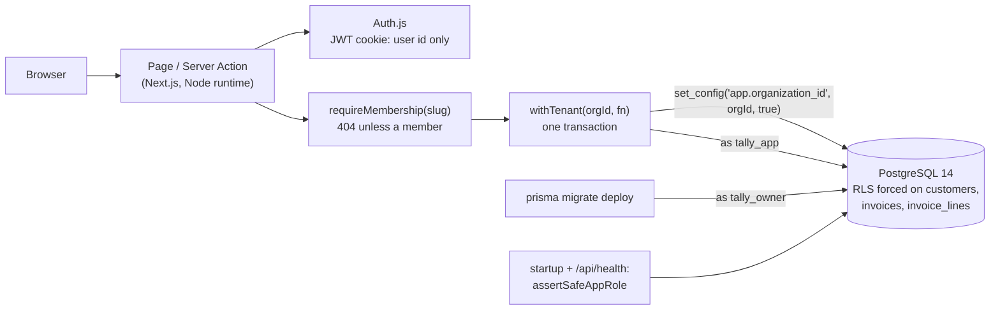

# Tally

A multi-tenant invoicing service. Businesses sign up as **organizations**, keep their **customers**, and (from day
2) send them **invoices**. Every organization's data lives in one shared Postgres database, so the property the
whole design is built around is **tenant isolation**: a request made for one organization can't read or change
another's data, even when the application code has a bug.

Next.js 16 (App Router, Server Components, Server Actions), Prisma 7 with the `pg` driver adapter, PostgreSQL 14
row-level security, Auth.js v5, Zod, Vitest, Playwright, TypeScript.

**Status: day 1 of 5.** Design, scaffold, schema and migrations with row-level security, database roles, sign-up and
sign-in, the first tenant page, tests and CI. [DESIGN.md](DESIGN.md) is the specification;
[WALKTHROUGH.md](WALKTHROUGH.md) answers the questions an interviewer is likely to ask.

## Why

Most multi-tenant bugs are a missing `WHERE organization_id = ...`: one forgotten filter in one query, and a
customer sees another company's invoices. Tally doesn't rely on every query remembering. Isolation is enforced in
three places, each enough to stop that bug on its own:

1. **Every tenant route resolves a membership first.** `/o/[slug]/...` pages call `requireMembership(slug)`, which
   answers 404 for a non-member exactly as for a slug that doesn't exist.
2. **Tenant data is only reached through `withTenant(orgId, fn)`**, which runs `fn` in one transaction after
   `set_config('app.organization_id', orgId, true)`. The setting is transaction-local, so a pooled connection never
   carries a tenant into the next request.
3. **Postgres row-level security**, enabled and *forced* on every tenant table, filters every query (Prisma's or raw
   SQL) to the tenant in that setting, and refuses writes into any other. The application connects as `tally_app`:
   not a superuser, no `BYPASSRLS`, owns nothing, so the policies bind it. The server checks this at startup and
   exits if they wouldn't.

On top of that, composite foreign keys (`(organization_id, customer_id)` → `customers (organization_id, id)`) make a
row that references another tenant's row impossible to store.

## Architecture



## Layout

```
DESIGN.md                        the specification
prisma/schema.prisma             the data model
prisma/migrations/               SQL: tables and CHECKs; row-level security and grants
scripts/db-setup.sh              roles (tally_owner, tally_app) and databases, idempotent
scripts/bench-tenant.ts          what isolation costs per query
scripts/bench-signin.ts          whether sign-in timing reveals which emails exist
src/server/db/tenant.ts          withTenant
src/server/db/role-check.ts      assertSafeAppRole: is RLS binding this connection?
src/server/auth/                 passwords (scrypt), Zod schemas, credentials, sign-up
src/server/dal.ts                requireUser, requireMembership
src/auth.ts                      Auth.js configuration
src/app/                         pages, Server Actions, /api/auth, /api/health
tests/unit, tests/integration    Vitest (integration tests against real Postgres)
e2e/                             Playwright
```

## Running it

Requirements: Node 22.12+ or 24 (Prisma 7's range), PostgreSQL 14 on localhost:5432 with trust authentication for
local connections (Homebrew's default), and Google Chrome for the e2e tests.

```bash
npm install
scripts/db-setup.sh                 # roles tally_owner + tally_app; databases tally, tally_test, tally_e2e
cp .env.example .env                # then set AUTH_SECRET: openssl rand -base64 32
npm run db:migrate                  # as tally_owner
npm run dev                         # http://localhost:8117
```

For production mode locally, `npm run build && AUTH_TRUST_HOST=true npm start` (Auth.js wants the trusted host stated
outside development). The server checks at startup that its database role is bound by row-level security and exits
if it isn't, so a `DATABASE_URL` pointing at `tally_owner` or a superuser won't start.

Checks:

```bash
npm run check                       # typecheck, lint, unit + integration tests (needs Postgres)
npm run build && npm run e2e        # Playwright against next start on :8117, database tally_e2e
scripts/db-setup.sh tally_bench && npm run bench && npm run bench:signin
```

On Node 23 (this Mac's), Prisma's preinstall refuses to run; `npm ci --ignore-scripts && npx prisma generate` works,
and everything else runs.

## Results (day 1)

All measured on an Apple M3 laptop (macOS 26.6.2, Node 23.11, Postgres 14.20), on AC power.

- **Tests:** 115 Vitest tests (`npx vitest run`, 2.2 s): 54 unit, 61 integration against Postgres (mostly as `tally_app`);
  5 Playwright tests (`npm run e2e`, 5.3 s). Every CI step passed in a fresh clone of the repository.
- **The cost of isolation** (`npm run bench`, synthetic: 100 tenants x 1,000 customers; one tenant's customer count,
  3,000 times per path, interleaved; one connection each; load average 3.9 with a review agent running):

  | Path | p50 | p95 | p99 |
  |---|---|---|---|
  | superuser, explicit `WHERE`, no RLS (one round trip) | 426 µs | 1,717 µs | 2,280 µs |
  | `withTenant` (RLS adds the filter) | 783 µs | 3,161 µs | 3,845 µs |
  | `withTenant` plus an explicit `WHERE` | 794 µs | 3,128 µs | 3,965 µs |

  The cost is the three extra round trips (`BEGIN`, `set_config`, `COMMIT`), not the policy: Postgres plans the RLS
  query and the explicit one the same way, a bitmap index scan on `customers_organization_id_id_key`
  (`tests/integration/rls-plan.test.ts` pins that the policy can use an index).
- **Password hashing:** one scrypt (N = 2^15, r = 8, p = 1) takes 45.5 ms at the median (20 runs, min 45.4, max
  46.7: a `node -e` timing loop over `crypto.scrypt`).
- **Sign-in timing doesn't reveal accounts** (`npm run bench:signin`: the whole credential check, 200 attempts of
  each kind, interleaved, load 2.3):

  | Attempt | p10 | p50 | p90 |
  |---|---|---|---|
  | wrong password for a real account | 49.9 ms | 50.4 ms | 52.5 ms |
  | email with no account | 49.9 ms | 50.4 ms | 52.1 ms |
  | right password | 49.9 ms | 50.4 ms | 52.6 ms |

  With the dummy hash removed (a mutation, 60 rounds), an unknown email answered in 0.8 ms at the median against
  49.7 ms for a wrong password: a timing oracle for which emails are registered.

## Design decisions

- **RLS as well as application filters, not instead of them.** The application still resolves memberships and
  scopes by organization; RLS is what still holds when one of those is forgotten.
- **A transaction per tenant request.** `set_config(..., true)` only lives inside a transaction, which is what makes
  it safe with a connection pool (and with PgBouncer in transaction mode). The price is three round trips per
  request, measured above.
- **The app role can't be the owner.** Table owners skip RLS unless it's forced, superusers and `BYPASSRLS` roles
  always skip it. So there are two roles, the policies are forced, and the server refuses to start as anything RLS
  doesn't bind.
- **Composite foreign keys.** They make cross-tenant references unrepresentable and close a side channel: Postgres
  checks foreign keys without row security, so a plain `customer_id` key would tell a tenant whether another
  tenant's id exists.
- **Sessions carry identity, not authority.** The JWT holds only the user id; memberships and roles are read on
  every request, so removing someone takes effect immediately even though JWTs can't be revoked.
- **scrypt from Node's standard library**, parameters stored per hash, NFKC-normalized input, a dummy hash for
  unknown emails so sign-in timing doesn't reveal accounts.

## Limitations (day 1)

- Only sign-up, sign-in and an organization overview exist; customers and invoices arrive on day 2, billing on day
  3, roles enforced and the full isolation suite on day 4.
- Sign-up tells you when an email already has an account (as most sign-up forms do); hiding that needs an email
  verification flow, which needs an email provider.
- No rate limiting on sign-in yet (day 4).
- `users`, `organizations` and `memberships` have no row-level security: they're read before a tenant is known, and
  are reached only through code that filters by the signed-in user.
- Auth.js v5 is still published as a beta (`5.0.0-beta.32`).

MIT licensed.
