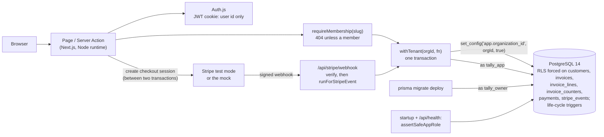

# Tally

A multi-tenant invoicing service. Businesses sign up as **organizations**, keep their **customers**, and send them
**invoices** with exact totals, gapless numbers and PDFs, which customers pay by card through a hosted checkout page. Every organization's data lives in one shared Postgres database, so the property the
whole design is built around is **tenant isolation**: a request made for one organization can't read or change
another's data, even when the application code has a bug.

Next.js 16 (App Router, Server Components, Server Actions), Prisma 7 with the `pg` driver adapter, PostgreSQL 14
row-level security, Auth.js v5, Zod, Vitest, Playwright, TypeScript.

**Status: day 3 of 5.** Day 1: design, scaffold, schema and migrations with row-level security, database roles,
sign-up and sign-in, tests and CI. Day 2: customers; invoices with line items, totals and per-rate taxes in exact
integer arithmetic; gapless per-organization numbering and the invoice life cycle enforced by the database; invoice
PDFs. Day 3: billing: payment links for open invoices through a provider interface (a Stripe-like mock by default,
Stripe's test mode opt-in), signed webhooks processed exactly once, the payment life cycle enforced by the database. [DESIGN.md](DESIGN.md) is the specification;
[WALKTHROUGH.md](WALKTHROUGH.md) answers the questions an interviewer is likely to ask.

## Why

Most multi-tenant bugs are a missing `WHERE organization_id = ...`: one forgotten filter in one query, and a
customer sees another company's invoices. Tally doesn't rely on every query remembering. Isolation is enforced in
three places, each enough to stop that bug on its own:

1. **Every tenant route resolves a membership first.** `/o/[slug]/...` pages call `requireMembership(slug)`, which
   answers 404 for a non-member exactly as for a slug that doesn't exist.
2. **Tenant data is only reached through `withTenant(orgId, fn)`**, which runs `fn` in one transaction after
   `set_config('app.organization_id', orgId, true)`. The setting is transaction-local, so a pooled connection never
   carries a tenant into the next request.
3. **Postgres row-level security**, enabled and *forced* on every tenant table, filters every query (Prisma's or raw
   SQL) to the tenant in that setting, and refuses writes into any other. The application connects as `tally_app`:
   not a superuser, no `BYPASSRLS`, owns nothing, so the policies bind it. The server checks this at startup and
   exits if they wouldn't.

On top of that, composite foreign keys (`(organization_id, customer_id)` → `customers (organization_id, id)`) make a
row that references another tenant's row impossible to store, and the application role's grants are column by column:
it can't choose or change ids, change `organization_id`, or delete organizations or users, because cascades and key
checks run without row security.

Invoices add a second kind of guarantee, about money rather than tenants:

- **Amounts are integers** (`bigint` minor units), quantities and tax rates exact thousandths; input with more
  decimals than it can hold is refused, never rounded; one stated rounding rule (half up per line, then once per
  tax rate) is implemented in TypeScript for display and in SQL for the stored totals, and a differential test keeps
  the two equal.
- **Invoice numbers have no gaps**, per organization, even with concurrent finalizations and rollbacks: the number
  comes from a counter row locked by the finalizing transaction, so a rollback hands it back.
- **Final means final, for every writer.** Triggers enforce the life cycle (draft → open → paid or void), assign the
  number, issue time and totals themselves (the application has no privilege on those columns), and refuse any change
  to a final invoice or its lines, including from raw SQL that skips the services.

Billing (day 3) adds a third: **money moves once, and is never lost.**

- **Webhooks are authentic and take effect once.** The signature (HMAC-SHA256 over the raw body, constant-time,
  five-minute tolerance) is checked first; then the event's id goes into an inbox table as the first statement of its
  transaction, so a redelivery, even ten at once, finds it and changes nothing.
- **The tenant comes from Stripe's signature, not a login.** The organization is named in the checkout session's
  metadata, which Stripe signs; the data access layer only accepts a verified event's type, and row security still
  limits the event to that organization's payments.
- **Payments only move forward, and money that arrives is always recorded:** a late success after an expiry still
  counts; money for an invoice that's already paid or void, or for the wrong amount, is kept with a "refund due" flag
  instead of paying anything. A trigger enforces the life cycle and freezes what a payment is for.

## Architecture



## Layout

```
DESIGN.md                        the specification
prisma/schema.prisma             the data model
prisma/migrations/               SQL: tables and CHECKs; row-level security and grants
scripts/db-setup.sh              roles (tally_owner, tally_app) and databases, idempotent
scripts/bench-tenant.ts          what isolation costs per query
scripts/bench-signin.ts          whether sign-in timing reveals which emails exist
scripts/bench-finalize.ts        what gapless numbering costs: one organization vs many
scripts/bench-webhook.ts         what the webhook path costs: fresh events and redeliveries
scripts/sample-pdf.ts            sample invoice PDFs (synthetic) for looking at the layout
scripts/stripe-smoke.ts          checks the Stripe client against Stripe's test mode (needs your key)
src/server/db/tenant.ts          withTenant
src/server/db/role-check.ts      assertSafeAppRole: is RLS binding this connection?
src/server/auth/                 passwords (scrypt), Zod schemas, credentials, sign-up
src/server/dal.ts                requireUser, requireMembership, requireTenant
src/server/invoices/money.ts     exact arithmetic: parsing, rounding, totals, formatting
src/server/invoices/service.ts   customers, drafts, lines, finalize, paid, void (inside a tenant transaction)
src/server/invoices/pdf.ts       the PDF writer
src/server/billing/              provider interface, mock + Stripe clients, limits, signatures, events,
                                 payment links and event processing (service.ts), the webhook handler
src/auth.ts                      Auth.js configuration
src/app/                         pages, Server Actions, /api/auth, /api/health, /o/[slug]/invoices/[id]/pdf,
                                 /api/stripe/webhook, /mock-checkout/[id], /paid
tests/unit, tests/integration    Vitest (integration tests against real Postgres)
e2e/                             Playwright
```

## Running it

Requirements: Node 22.12+ or 24 (Prisma 7's range), PostgreSQL 14 on localhost:5432 with trust authentication for
local connections (Homebrew's default), and Google Chrome for the e2e tests.

```bash
npm install
scripts/db-setup.sh                 # roles tally_owner + tally_app; databases tally, tally_test, tally_e2e
cp .env.example .env                # then set AUTH_SECRET: openssl rand -base64 32
npm run db:migrate                  # as tally_owner
npm run dev                         # http://localhost:8117
```

Billing runs on the mock provider unless configured otherwise: "Create payment link" on an open invoice opens
`/mock-checkout/<session>`, where you play the customer (pay by card or bank debit, let it expire, resend an event)
and watch the webhook's answers. To use Stripe's test mode with your own keys, set `BILLING_PROVIDER=stripe`,
`STRIPE_SECRET_KEY=sk_test_...` and `STRIPE_WEBHOOK_SECRET=whsec_...` (from `stripe listen --forward-to
localhost:8117/api/stripe/webhook`); `npx tsx scripts/stripe-smoke.ts` checks the client against Stripe first. A live
key is refused at startup.

For production mode locally, `npm run build && AUTH_TRUST_HOST=true npm start` (Auth.js wants the trusted host stated
outside development). The server checks at startup that its database role is bound by row-level security and exits
if it isn't, so a `DATABASE_URL` pointing at `tally_owner` or a superuser won't start.

Checks:

```bash
npm run check                       # typecheck, lint, unit + integration tests (needs Postgres)
npm run build && npm run e2e        # Playwright against next start on :8117, database tally_e2e
scripts/db-setup.sh tally_bench && npm run bench && npm run bench:signin && npm run bench:finalize && npm run bench:webhook
npx tsx scripts/sample-pdf.ts .scratch/pdf   # writes sample PDFs (synthetic invoices)
```

On Node 23 (this Mac's), Prisma's preinstall refuses to run; `npm ci --ignore-scripts && npx prisma generate` works,
and everything else runs.

## Results (day 2)

Apple M3 laptop (macOS 26.6.2, Node 23.11, Postgres 14.20). The first benchmark run was on battery; the final ones on
AC, with a review agent running tests on the same machine (load average 4.7 to 5.5).

- **Tests:** 392 Vitest tests in 50 files (`npm run check`, 26.24 s with files run one at a time), 183 of them new
  today; 16 Playwright tests (`npm run e2e`, 11.8 s), 5 new. Among the new: money.ts against a differently written
  oracle (20,000 random roundings, 3,000 random invoices); SQL `invoice_totals()` equal to money.ts on 600 random
  invoices, where per-line rounding would have differed on more than 50 (`tests/integration/totals-differential.test.ts`;
  making money.ts round half down fails it); the life cycle through the services and through raw SQL;
  **40 concurrent finalizations with 10 rolled back numbered exactly 1..30**; a line insert racing a finalization,
  and a draft racing its customer's deletion, each shown blocked on the lock in `pg_stat_activity`, then refused; the
  PDF's every xref offset, its text, pagination, encoding and margins; the four review rounds' findings
  (`tests/review-d2/` to `tests/review-d2r4/`); e2e of a draft finalized to INV-0001 with a total worked out by hand
  ($53.42), its PDF, the customer and draft actions, and 404s for another organization's ids.
- **What gapless numbering costs** (`npm run bench:finalize` on the final code: 1,000 finalizations per case after
  100 warm-up, each invoice 5 lines, through `withTenant` as `tally_app`, a pool of as many connections as workers;
  synthetic; on AC, load 5.2 → 4.7, slept 1 ms):

  | Case | Workers | Finalizations/s | p50 | p95 | p99 |
  |---|---|---|---|---|---|
  | one organization | 1 | 771 | 1.25 ms | 1.83 ms | 2.32 ms |
  | spread over organizations | 1 | 813 | 0.89 ms | 2.01 ms | 4.09 ms |
  | one organization | 4 | 1,507 | 2.31 ms | 4.33 ms | 7.18 ms |
  | spread | 4 | 2,171 | 1.67 ms | 2.64 ms | 5.01 ms |
  | one organization | 16 | 1,669 | 6.49 ms | 23.52 ms | 34.95 ms |
  | spread | 16 | 2,655 | 5.63 ms | 8.32 ms | 10.19 ms |

  One organization's finalizations take turns on its counter row from the upsert to `COMMIT` (three round trips), so
  at 16 concurrent finalizers in one organization the p95 is about three times the spread case's and throughput stops
  growing; across organizations nothing waits. A repeat run right after gave the same shape (16 workers: p95 24.46 ms
  vs 7.53 ms, 1,710 vs 2,882/s), and so did the first run, on battery before the counter guard and the bill-to copy
  were added (22.57 ms vs 7.29 ms, 2,033 vs 3,076/s). With one worker nothing waits, so the two 1-worker rows measure
  the same path; I put their gap, and the drift between runs (579 to 1,181/s), down to run-to-run noise on a loaded laptop
  (the cases run one after another, not interleaved); that's an inference, not something I measured. 16 simultaneous finalizations in one organization is far beyond what
  an invoicing tenant does, so the lock is the right trade for numbers without gaps. Every run ends by checking each
  organization's numbers are exactly 1..n.
- **PDFs:** 0.115 ms for a 2-line invoice (3,055 bytes) and 0.535 ms for 100 lines over 4 pages (28,541 bytes),
  median of 200 (same run). On the sample invoices, pdfplumber's text extraction returns every field and every
  right-aligned line ends within 0.004 pt of the margin (amounts in € excepted: pdfminer's built-in Helvetica metrics
  have no Euro glyph). The writer's widths for all 120 non-ASCII characters Windows-1252 can encode match pdfminer's
  Helvetica metrics (regular weight; bold not compared).

## Results (day 1)

All measured on an Apple M3 laptop (macOS 26.6.2, Node 23.11, Postgres 14.20), on AC power.

- **Tests:** 209 Vitest tests (`npx vitest run`, 22 s with files run one at a time): unit, integration tests
  against Postgres (mostly as `tally_app`), two architecture rules over the source, and the review rounds' tests
  (`tests/review/`, `tests/review2/`); 11 Playwright tests (`npm run e2e`, 6.5 s). Every CI step passed in a fresh clone
  of the repository.
- **The cost of isolation** (`npm run bench`, synthetic: 100 tenants x 1,000 customers; one tenant's customer count,
  3,000 times per path, interleaved; one connection each; load average 3.4; final code):

  | Path | p50 | p95 | p99 |
  |---|---|---|---|
  | superuser, explicit `WHERE`, no RLS (one round trip) | 409 µs | 527 µs | 654 µs |
  | `withTenant` (RLS adds the filter) | 914 µs | 1,314 µs | 1,927 µs |
  | `withTenant` plus an explicit `WHERE` | 919 µs | 1,345 µs | 2,253 µs |

  The cost is the four extra round trips (`BEGIN`, one `set_config` statement for the tenant and the timeouts, the
  `SELECT 1` that catches an aborted transaction, `COMMIT`), paid once per request rather than per query; not the
  policy: Postgres plans the RLS query and the explicit one the same way, a bitmap index scan on
  `customers_organization_id_id_key` (`tests/integration/rls-plan.test.ts` pins that the policy can use an index).
  Earlier runs, before the reviews' fixes: 426 / 783 / 794 µs at the median (load 3.9, no `SELECT 1`), then 393 /
  851 / 858 µs (load 3.0).
- **Password hashing:** one scrypt (N = 2^15, r = 8, p = 1) takes 45.5 ms at the median (20 runs, min 45.4, max
  46.7: a `node -e` timing loop over `crypto.scrypt`).
- **Sign-in timing doesn't reveal accounts** (`npm run bench:signin`: the whole credential check, 200 attempts of
  each kind, interleaved, load 2.8):

  | Attempt | p10 | p50 | p90 |
  |---|---|---|---|
  | wrong password for a real account | 49.2 ms | 49.6 ms | 52.0 ms |
  | email with no account | 49.2 ms | 49.6 ms | 52.1 ms |
  | right password | 49.3 ms | 49.6 ms | 51.8 ms |

  With the dummy hash removed (a mutation, 60 rounds), an unknown email answered in 0.8 ms at the median against
  49.7 ms for a wrong password: a timing oracle for which emails are registered.

## Review

### Day 2

A review agent at `0eff04c` (its own worktree and database, 11 minutes, findings as failing tests in
`tests/review-d2/`), every finding reproduced here before fixing:

- **The invoice counter was writable by the application.** `invoices_guard` runs as the caller, so the role needs
  `INSERT`/`UPDATE` on `invoice_counters`, and any statement could use them: `+41` made the next invoice number 43.
  Fixed with a guard trigger that accepts counter writes only from inside another trigger, one step at a time.
- **Temporary tables could shadow the triggers' tables** (`search_path` without `pg_temp` searches it first): with a
  `TEMP` grant, finalization stored a total of 1 for a real 100,000. The application has no `TEMP`, so latent; fixed by
  listing `pg_temp` last, and the role check now refuses `TEMP`/`CREATE` and missing or disabled guard triggers.
- **A line could move out of a final invoice** with an `UPDATE (invoice_id)` grant (not granted; latent). The
  trigger now refuses any change of a line's invoice, and the role check forbids the grant.
- **PDF text off the page or overlapping:** 100 tax rates pushed the Total below the page; a 60-line address pushed
  the table off page 1; a 200-character name ran to x = 1,220 on a 612 pt page; at the input limits the amount
  overlapped the Tax column. The old margin test couldn't see any of it (its regex skipped negative coordinates).
- Its suspicions, each confirmed by a test of mine and fixed: an issued invoice showed the customer's *current*
  details (now copied at finalization); a customer deleted mid-request made a draft's creation a 500 (now "no
  customer"); bidirectional override characters were accepted in names and descriptions (now refused).

Round 2 (at `4cb2c26`, on round 1's fixes, 13 minutes, `tests/review-d2r2/`): seven bugs, five of them in or
next to round 1's fixes:

- the role check passed a connection with `session_replication_role = replica` (no trigger fires, not the guards
  nor the foreign keys'), and called a guard set to `ENABLE ALWAYS` missing;
- deleting an organization with a final invoice depended on which cascade Postgres fired first (they fire in
  trigger-name order); the lines guard now lets the organization's own cascade through, like the invoices guard;
- PDF: round 1's fitted columns could squeeze a description into more lines than a page holds (drawn below the page);
  every non-ASCII character was measured as a digit (capitals with umlauts ran over the title); every INR amount
  printed "?53.42" (₹ isn't in Windows-1252: the PDF now prints "INR 53.42"); a decomposed é could be cut from its
  accent;
- the customer races, already fixed after the reviewed commit.

It also pointed out that the counter guard's refusal was mapped to a quiet "something went wrong"; it stays an error
now, so it's logged.

Round 3 (at `e6159ae`, on round 2's fixes and the changes no reviewer had seen, 7 minutes, `tests/review-d2r3/`):
three bugs, no database bug. Round 2's grapheme wrapping couldn't cut a single cluster wider than the line (a letter
with 60 combining marks put a name at x = 1,058 on a 612 pt page); the six-line address rule counted line breaks,
not printed lines, so an accepted address could lose its country on the PDF; the bidi refusal missed the
organization name and the zero-width direction marks. Fixed in `50ff59c`, together with a check that the worst
valid name, email and address print in full on page 1. 

Round 4 (at `baba0a3`, on round 3's fix only, 3 minutes, `tests/review-d2r4/`): two bugs in that fix's claim that
whatever the forms accept prints in full. Words that don't fit two to a line waste most of each, so a valid
194-character customer name wrapped to 15 lines and was cut at 9 (the form now refuses names that wouldn't print in
full); an ordinary 95-character organization name lost its end in the letterhead (it now drops to 12 pt over up to
four lines, and sign-up refuses only what wouldn't fit even then). Fixed in `4333c5d`. Every round found bugs in the
previous round's fixes; I stopped at four, with round 4's findings narrower than round 1's.

Found by my own tests on day 2: the issue time was taken before the number (so #N+1 could be stamped earlier than #N);
a duplicate customer email was a 500, because the service caught the unique violation inside a transaction Postgres
had already aborted; bold text was measured with regular widths (the "Amount" header overran the margin). A failure
that looked flaky: `tests/review2/orphan-writes.test.ts` failed twice with 25P02, each time while a review agent ran
tests. Once the test reported its inner error, the cause showed: the test's organization vanished mid-run
(`customers_organization_id_fkey`), because an agent ran unit test files without the test-database settings, so its
global setup truncated the default `tally_test` under my run. Test runs now hold an advisory lock on their database,
and a second run stops with a clear message (`77bf823`).

### Day 1

Two review rounds by a separate agent, each reviewing a fixed commit in its own worktree and database, writing every
finding as a failing test (`tests/review/`).

- **Round 1** (at `135c11c`): nine bugs. The serious ones: writes from another tenant's transaction through the
  tables RLS didn't cover (deleting an organization cascaded through its rows; a membership in another organization
  was accepted); unique and primary keys that answered "does this exist in another tenant?"; a Prisma 7.10 behaviour
  where a rejected transaction's in-flight nested write finished in autocommit after the `ROLLBACK`; a swallowed
  error reported as success; a role check that passed with an extra `USING (true)` policy. Also a startup check
  that could hang, unverifiable hash parameters, a NUL byte making sign-up a 500, and the deleted-user redirect loop
  (already fixed). Plus 18 surviving mutants, each now killed by a test. Fixes: `e98f346` and the commits before it.
- **Round 2** (at `e98f346`, on round 1's fixes): five bugs. A transaction that hit Prisma's own timeout still
  committed part of a nested write (statements are now bounded by `lock_timeout` and `statement_timeout` well inside
  a 30 s transaction timeout); the tracking view broke Prisma's fluent API; another organization's name and slug
  were still writable (the app may no longer update organizations); the role check passed a superuser session that
  set its role, `UPDATE` on users, an executable `SECURITY DEFINER` function and membership in `pg_write_all_data`;
  `parseHash` accepted hashes no scrypt can run. Plus 12 surviving mutants: 11 now fail tests; the wait for
  in-flight queries before `COMMIT` still survives its test (the `SELECT 1` orders `COMMIT` after the plan in every
  case I could build) and stays as a guard. Fixes: `41d7c03`, `1eaaacf`.

## Design decisions

- **RLS as well as application filters, not instead of them.** The application still resolves memberships and
  scopes by organization; RLS is what still holds when one of those is forgotten.
- **A transaction per tenant request.** `set_config(..., true)` only lives inside a transaction, which is what makes
  it safe with a connection pool (and with PgBouncer in transaction mode). The price is three round trips per
  request, measured above.
- **A Prisma behaviour to report upstream.** When an interactive transaction ends (rejection or Prisma's timeout)
  while an operation's multi-query plan is running, the rest of the plan runs in autocommit on the released
  connection. `withTenant` works around it; the reproductions are in `tests/review2/orphan-writes.test.ts`.
- **Least privilege, column by column.** Some writes skip row security even for the app role (cascades, unique-key
  checks), so its grants leave out everything those could abuse; the startup check verifies the grants and policies
  are exactly the migrations'.
- **The app role can't be the owner.** Table owners skip RLS unless it's forced, superusers and `BYPASSRLS` roles
  always skip it. So there are two roles, the policies are forced, and the server refuses to start as anything RLS
  doesn't bind.
- **Composite foreign keys.** They make cross-tenant references unrepresentable and close a side channel: Postgres
  checks foreign keys without row security, so a plain `customer_id` key would tell a tenant whether another
  tenant's id exists.
- **Sessions carry identity, not authority.** The JWT holds only the user id; memberships and roles are read on
  every request, so removing someone takes effect immediately even though JWTs can't be revoked.
- **scrypt from Node's standard library**, parameters stored per hash, NFKC-normalized input, a dummy hash for
  unknown emails so sign-in timing doesn't reveal accounts.

## Limitations (day 3)

- **Stripe itself is untested here.** The Stripe client is tested against a local stand-in that checks every request
  it sends, and the mock answers like Stripe where Tally depends on it, but nothing in this repository has talked to
  api.stripe.com: there is no key. `scripts/stripe-smoke.ts` is the check to run with a test key.
- No refunds or partial payments: PAID is final, and money that arrives for an invoice that doesn't want it is only
  flagged (`refund_due`, a "Refund due" badge); refunding it is done by hand in Stripe's dashboard.
- No reconciliation job: if the webhook endpoint were down longer than Stripe's three days of retries, events would
  be lost; listing Stripe's events since the last one seen would recover them.
- Events are applied inline, in the request (milliseconds; "Results (day 3)" has the numbers), not from a queue.
- A session whose row was never stored (a crash after creating it, then no retry) gets 404s, and so Stripe retries,
  for three days; it was never shown to anyone, so nobody can pay it.
- The mock keeps its sessions in memory: a restart forgets them (their payment rows stay PENDING until they expire
  by Tally's clock). In mock mode anyone holding a payment link can "pay" it, which is what a mock is for; a
  deployment sets `BILLING_PROVIDER=stripe`.
- KWD invoices can't be paid by card (Stripe's three-decimal rules unconfirmed).
- Roles and the full isolation suite are day 4: today any member can create payment links, mark paid or void.

## Limitations (day 2)

- Billing (Stripe) was day 3; roles enforced and the full isolation suite day 4.
- No discounts, credit notes or negative lines: every amount is non-negative, which is what lets "half up" and "half
  away from zero" be one rule. Tax is a rate per line; there are no tax-inclusive prices or compound taxes.
- PDFs use the standard Helvetica (no embedded font), so characters outside Windows-1252 print as "?" (a currency
  symbol outside it, like ₹, falls back to the ISO code in the PDF). Names and emails longer than the bill-to block's
  lines are clipped there with an ellipsis.
- The name and address rules tightened during the day's reviews. A customer saved before them (only in test databases)
  can fail validation when next edited, and the PDF clips such data rather than overflowing.
- A final invoice keeps its customer's details, but not the organization's own name: nothing can rename an
  organization yet, and day 4's settings page will need to snapshot it too.
- The due date is computed from the database's UTC date in the finalizing statement; if UTC midnight passes between
  that and the trigger's issue time (microseconds apart), a "due on receipt" finalization is refused and has to be
  retried.
- Prisma ran the day-2 migration outside a single transaction: on a database whose existing rows broke a new CHECK, it
  stopped halfway (seen on the local test database; recreated). A real deployment would run it in one transaction.

## Limitations (day 1)

- Only sign-up, sign-in and an organization overview existed on day 1.
- Sign-up tells you when an email already has an account (as most sign-up forms do); hiding that needs an email
  verification flow, which needs an email provider.
- No rate limiting on sign-in yet (day 4).
- `users` and `organizations` have no row-level security, and memberships none for reading: they're read before a
  tenant is known. Writes to them are limited by grants instead (no deletes, no id changes; memberships only for the
  transaction's tenant).
- Auth.js v5 is still published as a beta (`5.0.0-beta.32`).
- `npm audit`: no advisories in the production dependencies; 8 moderate ones in the lint toolchain, all the same
  minimatch advisory (GHSA-g3hv-75wg-m249) reached through typescript-eslint, whose `^10.2.2` range can't reach the
  fixed 11.0.1. It only ever sees the repository's own lint globs.

MIT licensed.
